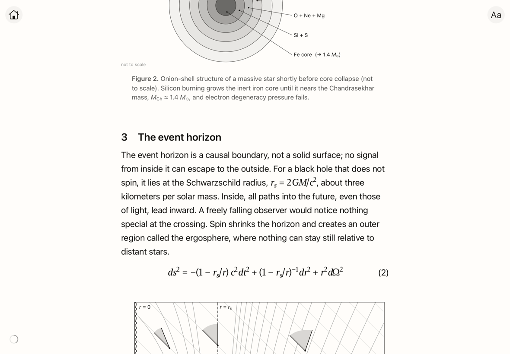
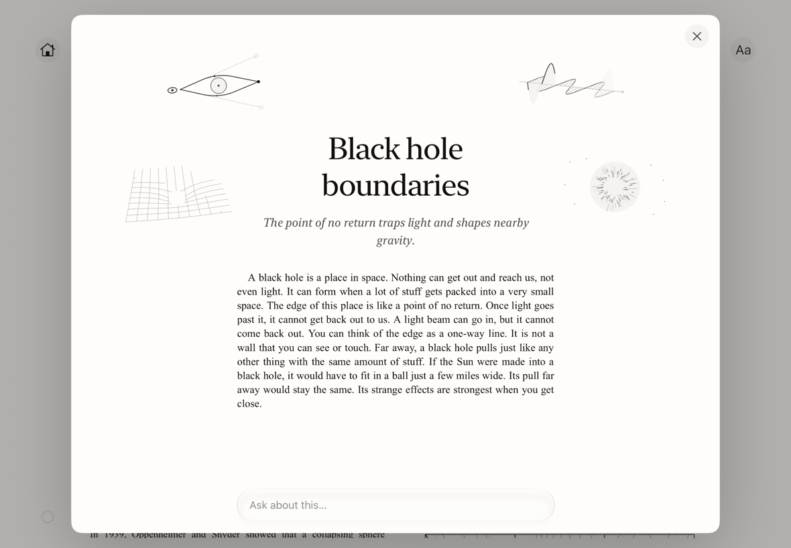
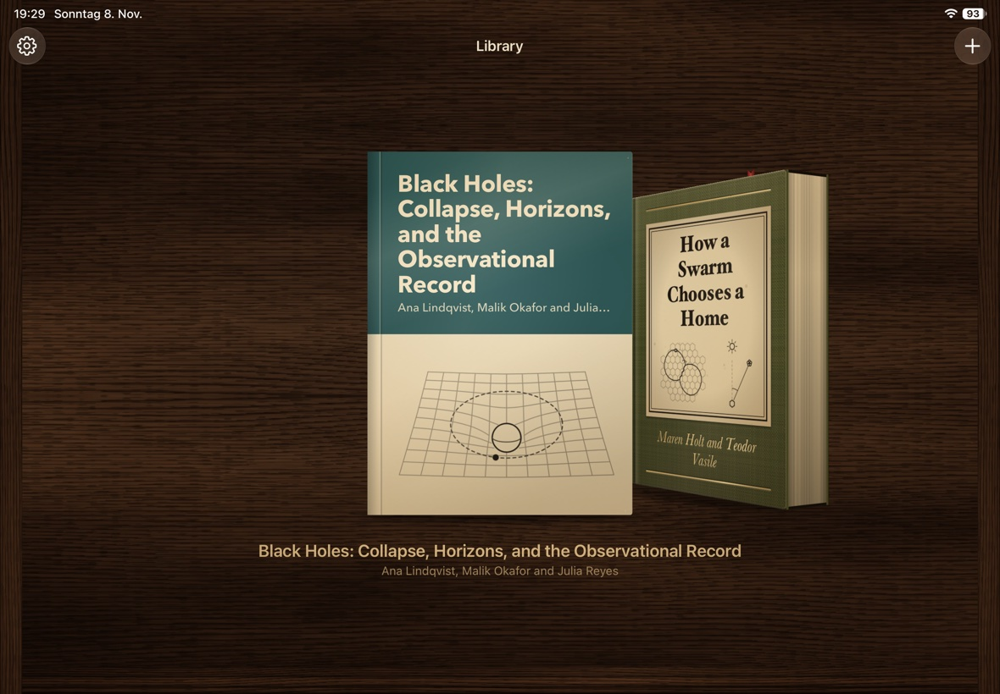

# Aube Reader

A reader for iPad where the text adapts to you.

<p align="center">
  
  
  
</p>

- **Pinch** a paragraph to make it shorter or longer.
- **Swipe** across it to make it simpler or harder. **Double-tap** to restore it.
- **Long-press** it for a closer look at its topic, with a drawing, and ask questions about it.
- **Import** any PDF, plain text or RTF file and read it as plain text, a clean paper, or the original pages (needs Sign in with ChatGPT or an API key).

Built with UIKit and no third-party dependencies. Uses OpenAI's models, on your ChatGPT plan (Sign in with ChatGPT) or your own API key.

## Build

Needs Xcode 26 or later and iOS 17 or later.

Open `AubeReader.xcodeproj` and run. The simulator needs no setup.

To run on a device, copy `Local.example.xcconfig` to `Local.xcconfig`
(git-ignored) and set your bundle ID and team.

The first time it opens, the app asks how to use AI, and Settings can change it
later:

- **Sign in with ChatGPT**: requests run on your ChatGPT Plus or Pro plan,
  through OpenAI's [Sign in with ChatGPT](https://developers.openai.com/siwc)
  for open-source apps: GPT-6.1 Sol at ultrafast speed, or where the plan
  turns that away, GPT-6.1 Terra at fast and then standard speed.
- **Enter API key**: your own OpenAI key, kept in the device's keychain.
- **Continue without AI**: the documents that come with the app, every version
  written ahead. Importing, rewriting and asking are off.

The project is generated from `project.yml` with
[XcodeGen](https://github.com/yonaskolb/XcodeGen). Run `xcodegen generate` after
adding or moving files.

## Layout

```
AubeReader/
  App/        app and scene delegates, documents, what's remembered
  Home/       library: books, shelf, welcome and AI setup
  Desk/       reader, footnotes, contents, topics, asking
  Settings/   settings pages
  Engine/     text layout, rewriting, TeX, OpenAI and Sign in with ChatGPT
  Import/     PDF and text import
  Support/    small helpers shared across the app
  Resources/  bundled documents
graphics/     animated drawings (see graphics/README.md)
tools/levels/ writes and checks the bundled documents' versions (Python 3)
```

## Bundled documents

The app comes with four papers, every version of each written ahead:

- “Attention Is All You Need”, Vaswani et al., NIPS 2017
  ([arXiv:1706.03762](https://arxiv.org/abs/1706.03762)).
- “Observation of Gravitational Waves from a Binary Black Hole Merger”, LIGO
  Scientific Collaboration and Virgo Collaboration, Phys. Rev. Lett. 116,
  061102 (2016), published under
  [CC BY 3.0](https://creativecommons.org/licenses/by/3.0/).
- “Black Holes: Collapse, Horizons, and the Observational Record” and “How a
  Swarm Chooses a Home”, two reviews made up for the app: their authors,
  journals and institutions are invented.

The rewritten versions are the app's own; the real papers belong to their authors.

## License

[MIT](LICENSE)
