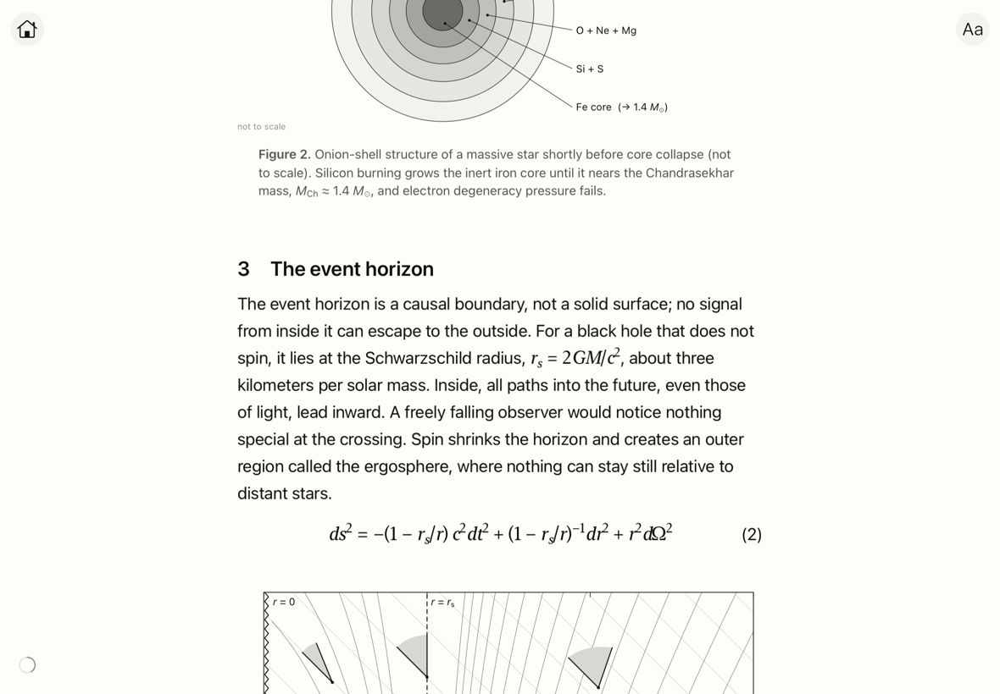
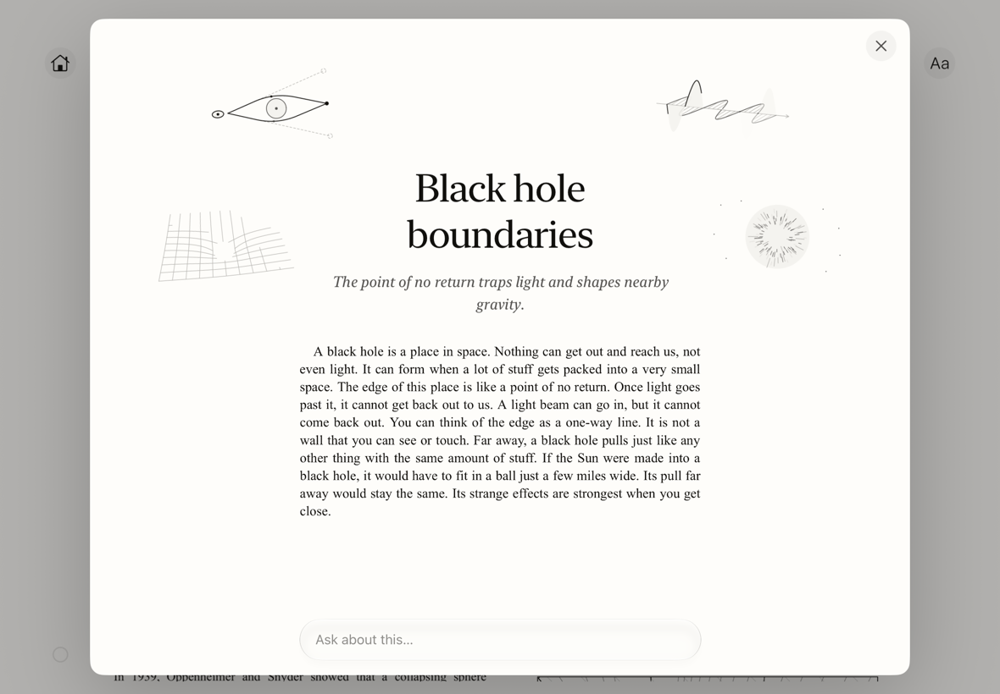
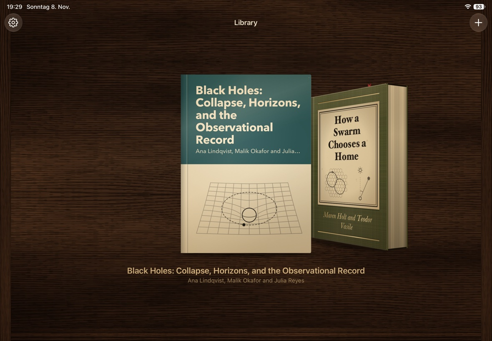

# Aube Reader

A reader for iPad where the text adapts to you.

<p align="center">
  
  
  
</p>

- **Pinch** a paragraph to make it shorter or longer.
- **Swipe** across it to make it simpler or harder. **Double-tap** to restore it.
- **Long-press** it for a closer look at its topic, with a drawing, and ask questions about it.
- **Import** any PDF, plain text or RTF file and read it as plain text, a clean paper, or the original pages.

Built with UIKit and no third-party dependencies. Uses the GPT API (bring your own key).

## Build

Needs Xcode 26 or later and iOS 17 or later.

Open `AubeReader.xcodeproj` and run. The simulator needs no setup.

To run on a device or use the AI features, copy `Local.example.xcconfig` to
`Local.xcconfig` (git-ignored) and set your bundle ID, team and OpenAI API key.
Without a key the app still works; rewriting, asking and import checking are off.
The key is embedded in the app, so never share a build that contains one.

The project is generated from `project.yml` with
[XcodeGen](https://github.com/yonaskolb/XcodeGen). Run `xcodegen generate` after
adding or moving files.

## Layout

```
AubeReader/
  Home/       library
  Desk/       reader, footnotes, topics, settings
  Engine/     text layout, rewriting, TeX, OpenAI
  Import/     PDF and text import
  Resources/  bundled documents
graphics/     animated drawings (see graphics/README.md)
```

## License

[MIT](LICENSE)
